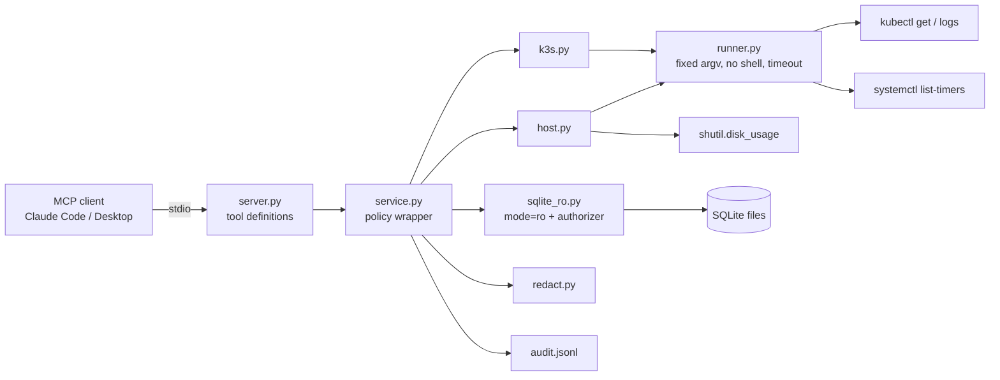

# homelab-mcp

A small [Model Context Protocol](https://modelcontextprotocol.io) server that lets an AI
assistant look at a k3s home lab without being able to change it. It reports CronJob and Job
status, shows recent Job logs, runs read-only SQLite queries, and lists systemd timers and
disk usage. Every output is redacted and every call goes to an audit log.

Status: Milestone 1 (read-only tools) is done. Milestone 2 (one approval-gated action and
client setup) has not started. See [SPEC.md](SPEC.md).

## How it works



Each tool call goes through `Service.call`, which:

1. checks policy (allowed namespace, known DB alias, allowed path, SELECT-only SQL),
2. runs the tool,
3. redacts every string in the result (API keys, GitHub/AWS/Slack tokens, JWTs, bearer
   tokens, private keys, emails, `*_KEY=`/`*TOKEN=`/`*PASSWORD=` values, plus your own
   patterns),
4. writes one JSON line to the audit log: time, tool, redacted arguments, allowed, ok,
   result size and duration,
5. returns the result. Errors come back as `{"error": ...}` (plus `"denied": true` when a
   policy check refused the call), so the server itself does not crash on a bad call.

### Tools

| Tool | What it returns | Limits |
|---|---|---|
| `k3s_cronjobs(namespace)` | schedule, time zone, suspended, last schedule, last success, active count | namespace must be in `allowed_namespaces` |
| `k3s_jobs(namespace, limit=10)` | newest Jobs: status (succeeded/failed/running/pending), start, end, duration, owning CronJob, failure reason | limit ≤ 50 |
| `job_logs(namespace, job, tail=100)` | last lines of the Job's pod logs, redacted, marked as untrusted | tail ≤ 200; job name must be a valid k8s name |
| `sqlite_query(db_alias, sql)` | columns and rows | one SELECT/WITH statement, ≤ 200 rows, timeout |
| `systemd_timers()` | unit, activated service, next and last run | |
| `disk_usage(paths=None)` | total/used/free GB and percent | paths must be under `disk.allowed_paths` |

### Why the SQL tool can't write

Any one of these layers blocks writes by itself:

1. Text check: exactly one statement, and it must start with `SELECT` or `WITH`.
2. The file is opened as `file:...?mode=ro`, so SQLite refuses writes and won't create files.
3. `PRAGMA query_only = ON`.
4. A SQLite authorizer allows only read, select and function calls. It denies `ATTACH`,
   `PRAGMA`, DDL, writes and `load_extension`. This catches cases the text check lets
   through, such as `WITH x AS (SELECT 1) DELETE FROM t`.

A progress handler stops queries that run past `sqlite.timeout_seconds`.

## Run it on the VM

Needs Python 3.11+, `kubectl` that can read the cluster, and systemd.

```bash
git clone https://github.com/iVoyd/homelab-mcp.git ~/homelab-mcp
cd ~/homelab-mcp
python3 -m venv .venv
.venv/bin/pip install -e ".[dev]"
mkdir -p ~/.config/homelab-mcp
cp config.example.toml ~/.config/homelab-mcp/config.toml
$EDITOR ~/.config/homelab-mcp/config.toml   # namespaces, DB paths
.venv/bin/homelab-mcp --selftest
```

On k3s, `/etc/rancher/k3s/k3s.yaml` is root-only by default. Either copy it to
`~/.kube/config` (owned by you, mode 600) or set `k3s.kubeconfig` in the config. A
read-only ServiceAccount kubeconfig is safer still: it needs `get`/`list` on `cronjobs`,
`jobs` and `pods`, and `get` on `pods/log`.

`--selftest` calls every tool once against the real host. It prints `OK`, `FAIL` or `SKIP`
per tool and exits non-zero on any failure. It also checks that a `DELETE` is refused.

To call a single tool when debugging:

```bash
.venv/bin/homelab-mcp --call k3s_jobs --args '{"namespace": "default", "limit": 3}'
```

The server itself runs on stdio (`.venv/bin/homelab-mcp`), started by an MCP client.
Milestone 2 will document client config. Until then, for Claude Code:

```bash
claude mcp add homelab -- ~/homelab-mcp/.venv/bin/homelab-mcp
```

## Development

```bash
.venv/bin/ruff check .
.venv/bin/pytest -q
```

The tests make no network calls and don't need kubectl or systemd. `tests/conftest.py`
swaps the subprocess runner for a fake that returns the files in `tests/fixtures/`. SQLite
tests use a temporary database.

## Results

| Check | Result |
|---|---|
| `pytest` (cloud dev container, Python 3.13) | 67 passed |
| `ruff check` | clean |
| stdio round trip with the MCP Python client | lists 6 tools; `sqlite_query` returns redacted rows |
| `--selftest` in the dev container | sqlite, SQL guard, disk OK; k3s and systemd FAIL as expected (no kubectl or systemd there) |
| `--selftest` on the PC1 VM | not run yet |

## Limitations

- The kubectl and systemctl fixtures were written by hand to match the real output
  formats. They were not recorded from this cluster. The VM selftest is the real check,
  and the systemd JSON field names (`next`, `last` in microseconds) need confirming there.
- `job_logs` uses `kubectl logs job/NAME`, which reads one pod. For a Job that retried,
  that may not be the pod that failed.
- Redaction uses patterns. It catches common token formats and `KEY=value` pairs, but
  will miss a bare secret with no recognisable shape. Add your own patterns under
  `[redaction]`.
- Log text and DB rows can contain prompt-injection text. The server marks logs as
  untrusted and tells the client so in its instructions, but it can't stop a client
  model from acting on them. Because every tool is read-only, the worst it can cause is a
  misleading answer, not a change to the lab.
- The server makes no LLM calls, so it has no tokens or cost to record.

## How this was built

Written with an AI coding assistant (Claude Code) from SPEC.md, and reviewed by Theo
O'Ferrall.
